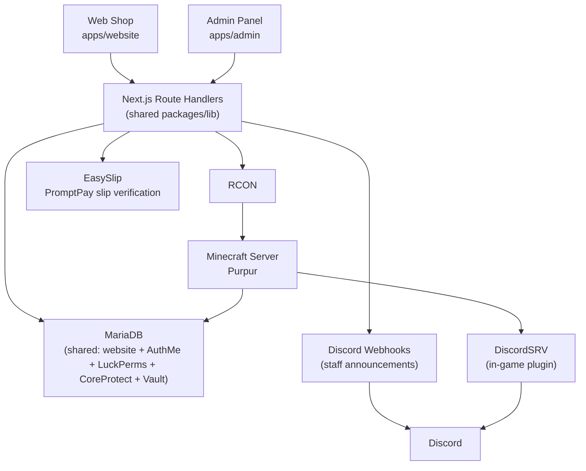

## Overview

CHEESEBRUHGER is a Minecraft server (Purpur, a Paper fork) with two web surfaces built as a pnpm/Turborepo monorepo: `apps/website` (the public shop, `shop.cheesebruhger.com`) and `apps/admin` (the staff-only panel), sharing a `packages/lib` package. Both apps are Next.js (App Router, TypeScript) with no separate API server — server-side logic lives in Next.js Route Handlers.

Authentication doesn't create a second identity system. NextAuth.js (Auth.js v5) uses a Credentials provider that checks player passwords against the `authme` table — the same account store the in-game AuthMe plugin owns. The website is a second front door onto an account that already exists on the server, not a new one. The admin app layers TOTP 2FA, backup codes, and trusted-device tracking on top of that same login.

The backend talks to the live Minecraft server exclusively over RCON — there's no other channel for the website to affect in-game state. MariaDB is shared between the website and the Minecraft plugins that need persistent storage (AuthMe, LuckPerms, CoreProtect, Vault economy). Real-money top-ups are verified through EasySlip. Two independent Discord integrations exist: outgoing webhooks from the website (staff-authored announcements), and the in-game DiscordSRV plugin (chat sync, account linking) plus a Skript-authored `/ticket` bridge for support tickets.

## System Diagram

## Core Concepts

### The Economy

CHEESEBRUHGER has four distinct currencies. They are never interchangeable, and code/UI referring to a balance always means exactly one of these:

| Term | What it is | Earned via | Spent on |
|---|---|---|---|
| **Credits** | Real-money wallet balance | PromptPay top-up (EasySlip-verified) | `shop.cheesebruhger.com` only |
| **Burger** (Xshards) | In-game currency | Playtime | Amethyst cosmetics, via the Skript bridge to AmethystItems |
| **$** (Vault balance) | General in-game economy | Jobs, in-game activity | EconomyShopGUI, Protection Stone Shop, etc. |
| **Job Points** | Job-specific currency | Paid alongside $ for job actions (e.g. mining) | Job market via `/jobs` |

Only Credits touch real money. `WalletBalance` (website-owned) tracks Credits; `$`, Job Points, and Burger all live in plugin-owned tables (Vault, a jobs plugin, and Xshards respectively) that the website never writes to directly.

### "Order" Is Overloaded

Two unrelated things are both called "order":

- **Web/admin Order** — the umbrella term for a player's top-ups plus shop purchases. This is what the admin's order-payment page reviews and what top-up disputes get appealed against.
- **In-game `/order`** — the command for the FoOrders plugin, a third-party player-to-player listing marketplace. Unrelated to the website entirely.

See [Minecraft Plugins](/en/docs/cheesebruhger/minecraft-plugins) for the full marketplace disambiguation (FoOrders vs. AuctionHouse vs. TradeUp).

### Payment Confirmation vs. In-Game Delivery

The top-up flow (see [Topup & EasySlip](/en/docs/cheesebruhger/api/topup-easyslip)) deliberately separates confirming a payment from delivering it in-game. A `delivery-poller` reconciles paid orders against RCON on a schedule, rather than delivering synchronously inside the payment request — this keeps a brief RCON outage from turning into a lost delivery.

## Layers

| Layer | Responsibility |
|---|---|
| `apps/website` | Public shop — top-up, shop items, inventory, redeem, account/2FA |
| `apps/admin` | Staff panel — RCON console, live terminal, audit log, tickets, promotions, moderation |
| `packages/lib` | Shared code between website and admin (DB access, RCON client, auth helpers) |
| Route Handlers | Backend logic — no separate API server |
| MariaDB | Shared database — website-owned tables plus plugin-owned tables (AuthMe, LuckPerms, CoreProtect, Vault) |
| Minecraft Server (Purpur) | The actual game server; all admin actions that touch it go over RCON |

## Related

- [Database Schema](/en/docs/cheesebruhger/database)
- [Minecraft Plugins](/en/docs/cheesebruhger/minecraft-plugins)
- [DevOps & Infrastructure](/en/docs/cheesebruhger/devops)
