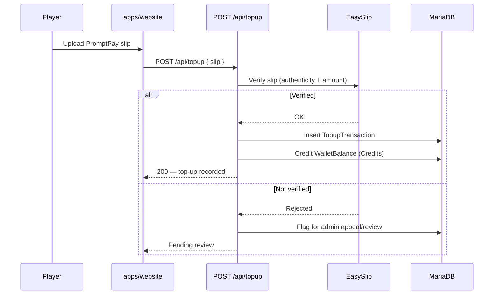
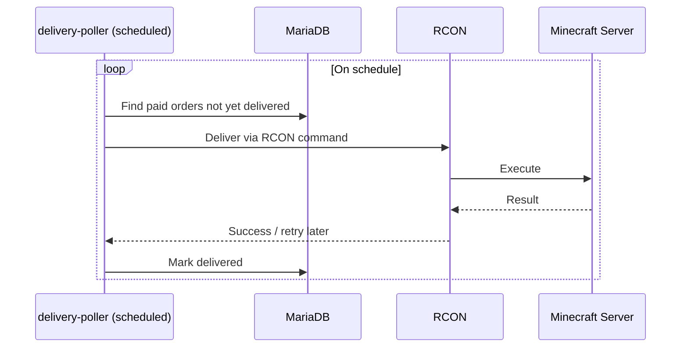

**Method:** `POST`
**Path:** `/api/topup`
**Layer:** Next.js Route Handler (`apps/website`)
**Rate limiting:** Yes — this endpoint is rate-limited to prevent slip-submission abuse.

## Purpose

Accepts a PromptPay bank-transfer slip upload from a player, verifies it against EasySlip, and — on success — records a `TopupTransaction` and credits the player's `WalletBalance` in Credits. Failed verifications route into an admin appeal/review flow rather than failing silently.

## Request

**Body** (multipart or JSON with a slip reference, depending on upload path):

| Field | Description |
|-------|-------------|
| Slip image | The uploaded PromptPay transfer slip |
| Player identity | Resolved from the authenticated session (Credentials provider / `authme`) |

## Verification Flow

1. Slip is submitted to EasySlip for verification (authenticity + amount match).
2. On success: a `TopupTransaction` row is written, and `WalletBalance` is credited — base rate 1 baht = 1 Credit, before 7% VAT on in-game real-money sales.
3. On failure: the submission is routed into an admin appeal/review queue instead of being rejected outright — a player can contest a slip EasySlip couldn't verify.

## Delivery Reconciliation — the `delivery-poller`

Crediting `WalletBalance` and delivering the effect of an order in-game are handled as two separate steps, not one. A scheduled `delivery-poller` reconciles paid orders (top-ups and shop purchases) against actual in-game state, delivering over RCON.

This is a pull rather than a push deliberately:

- If delivery happened synchronously inside the top-up request, a slip could verify successfully and then silently fail to deliver if RCON was briefly unreachable at that exact moment.
- Decoupling payment confirmation from in-game delivery means a brief RCON outage only delays delivery — it never loses it — and the top-up request never blocks on the game server being reachable.

## Related

- [Architecture](/en/docs/cheesebruhger/architecture)
- [Admin Ops API](/en/docs/cheesebruhger/api/admin-ops)
- [Database Schema](/en/docs/cheesebruhger/database)
