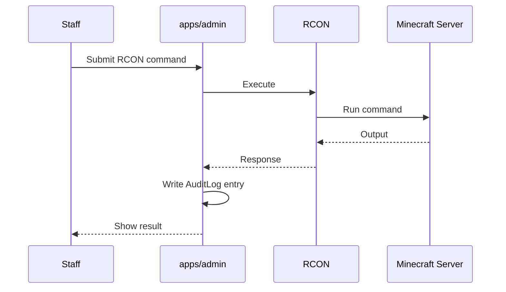

**Layer:** Next.js Route Handlers (`apps/admin`, backed by `packages/lib`)
**Auth:** Requires an authenticated staff session (Credentials provider against `authme`) with TOTP 2FA, backup codes, and trusted-device tracking layered on top.

## Purpose

`apps/admin` is the staff-only surface for running the server day to day. It's a collection of Route Handlers grouped by concern, all writing to `AuditLog` and all reachable only from the admin app — never linked from the public shop.

## RCON Console & Live Terminal

**Path:** `/api/admin/rcon`

Sends a single RCON command to the live Purpur server and returns its response. Every invocation is written to `AuditLog`.

The live terminal is a separate streaming connection that tails the Minecraft server's console output to the browser in real time, rather than polling — used for watching server behavior live (startup, crashes, plugin errors) without shelling into the box.

## Player Moderation

**Path:** `/api/admin/players`

Search and inspect players (cross-referenced against `authme`). Supports flagging a player as hidden (`HiddenPlayer`) so they don't appear in public-facing player lists — used for staff testing accounts and similar cases.

## Command Watchlist

**Path:** `/api/admin/watchlist`

Manages `FlaggedCommandPattern` entries — patterns matched against commands run in-game or via RCON, surfaced to staff for review rather than blocked outright.

## Support Tickets

**Path:** `/api/admin/tickets`

Reads and responds to `Ticket`/`TicketMessage` rows. Tickets can originate in-game (via the Skript-authored `/ticket` → Discord bridge, see [Minecraft Plugins](/en/docs/cheesebruhger/minecraft-plugins)) or be reviewed directly from the admin panel.

## Promotions & Redeem Codes

**Path:** `/api/admin/promotions`, `/api/admin/redeem-codes`

- `TopupPromotion` — time-limited bonus rules applied to PromptPay top-ups.
- `RedeemCode` / `RedeemCodeRedemption` — one-off or limited-use codes; a redemption row is written per player redemption to prevent reuse.

## Shop Item Management

**Path:** `/api/admin/shop-items`

CRUD over `ShopItem` — what's purchasable on the web shop, and at what Credit price.

## Plugin-Update Tracking

**Path:** `/api/admin/plugin-updates`

Tracks installed vs. available versions for server plugins, with particular attention to Geyser/Floodgate — since those are what let Bedrock players connect at all, a stale version there is a direct availability risk for part of the player base.

## Emergency Broadcast & Announcer Rotation

**Path:** `/api/admin/broadcast`, `/api/admin/announcer`

- `EmergencyBroadcast` — one-off urgent in-game messages, sent immediately via RCON.
- `AnnouncerRotationConfig` / `AnnouncerMessage` — the regular rotating announcer, configured from the admin panel rather than hardcoded in a plugin config.

## Discord Announcements

**Path:** `/api/admin/discord-announcements`

Staff-authored announcements (`DiscordAnnouncement`) posted out to Discord via outgoing webhooks. This is separate from the in-game `DiscordSRV` chat bridge — this path only ever sends staff-authored content outward, it never reads Discord.

## Related

- [Architecture](/en/docs/cheesebruhger/architecture)
- [Topup & EasySlip](/en/docs/cheesebruhger/api/topup-easyslip)
- [Database Schema](/en/docs/cheesebruhger/database)
