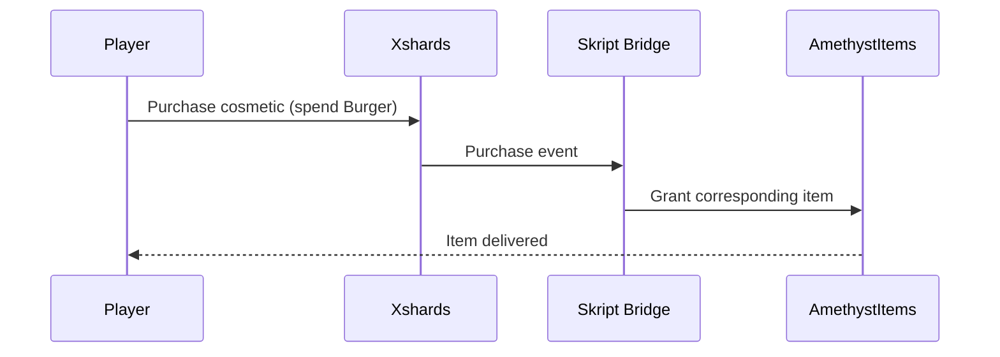

## Overview

The Minecraft-side engineering on CHEESEBRUHGER falls into three tiers of depth, from full custom plugins down to glue scripts:

1. **Built from scratch** — compiled plugins written entirely in-house.
2. **Forked and modified** — an existing open-source plugin, customized and patched.
3. **Skript-level scripting** — glue logic written in Skript rather than compiled Java, used where a full plugin would be overkill.

Alongside these, `DiscordSRV` is used unmodified as a third-party plugin for chat sync and account linking.

## Tier 1 — Built From Scratch

### TeamsCraft

A custom team system, written entirely in-house. Distinct from `UltimateTeams` (a separate third-party plugin present in the plugin stack — see [Database Schema](/en/docs/cheesebruhger/database)); the two are not related and don't share data.

### TradeUp

A custom item trade-up mechanic — players combine items to upgrade them into something better. This is **not** a marketplace. It's worth stating plainly because the name and the surrounding plugin stack invite confusion: TradeUp doesn't list, sell, or auction anything. See [Marketplace Disambiguation](#marketplace-disambiguation) below for how it relates to the plugins that actually are marketplaces.

## Tier 2 — Forked and Modified

### AmethystItems

Started from an open-source cosmetic-item-shop plugin, forked and customized for CHEESEBRUHGER's needs.

One concrete fix made during that work: patching the `Xshards` marketplace jar to correct a bug where purchase-confirmation messages displayed the wrong item name. Xshards is the plugin providing the Burger currency and its shop UI; AmethystItems is the cosmetic catalog that Burger purchases ultimately grant. The naming bug was in the message Xshards showed after a purchase, not in AmethystItems itself — fixing it meant patching the third-party jar directly rather than working around it downstream.

## Tier 3 — Skript-Level Scripting

Two integrations are implemented as Skript scripts rather than compiled plugins, because both are narrow, single-purpose bridges between two systems that otherwise don't talk to each other:

### `/ticket` → Discord Bridge

A custom Skript script implementing the in-game `/ticket` command. Opening a ticket in-game creates a `Ticket`/`TicketMessage` record and posts it to Discord, so staff can respond from either side.

### Xshards → AmethystItems Bridge

A Skript script that listens for Xshards shop purchases and, on a successful purchase, grants the corresponding item through AmethystItems. This is the mechanism behind the Burger economy row in the [economy glossary](/en/docs/cheesebruhger/architecture#core-concepts): Burger is earned through playtime (tracked by Xshards) and spent on Amethyst cosmetics, with this script as the connective tissue between the two plugins.

## Third-Party: DiscordSRV

`DiscordSRV` handles two things unmodified: in-game chat sync to a Discord channel, and account linking between a player's Minecraft and Discord identities. It is independent of the website's own Discord integration (outgoing webhooks for staff announcements — see [Admin Ops API](/en/docs/cheesebruhger/api/admin-ops)); the two never share code or state.

## Marketplace Disambiguation

Three separate in-game systems can look like "a place to trade things." They are not interchangeable, and none of them talk to each other:

| Command | Plugin | What it is |
|---|---|---|
| `/order` | FoOrders (third-party) | Player-to-player listings — post an item for sale, another player buys it |
| `/ah` | AuctionHouse (third-party) | A separate auction system — bid-based, distinct from FoOrders' fixed listings |
| *(no dedicated command noted)* | TradeUp (custom, Tier 1) | Not a marketplace — an item trade-up/upgrade mechanic |

This is also distinct from the web/admin use of the word "Order" (a player's top-ups + shop purchases, reviewed on the admin's order-payment page) — see [Architecture](/en/docs/cheesebruhger/architecture#order-is-overloaded).

## Bugs Found and Fixed

Two smaller issues surfaced and were corrected during plugin work, noted here rather than headlined:

- **`MrUltimateJobs` silent payout bug** — a job payout that failed without any visible error, found and fixed.
- **Crate rarity-weight math** — the probability weighting used for crate drop rarities was computed incorrectly, skewing drop odds until corrected.

## Related

- [Architecture](/en/docs/cheesebruhger/architecture)
- [Database Schema](/en/docs/cheesebruhger/database)
