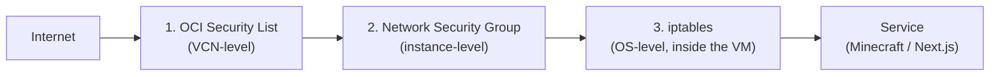

## Infrastructure Overview

| Service | What it provides |
|---|---|
| Oracle Cloud (OCI) | 2 free-tier VPS instances — 4 OCPU / 24GB RAM combined |
| Cloudflare | DNS + CDN in front of both the website and the Minecraft server's domain |

Both VPS instances run on Oracle's Always Free tier — **$0 compute cost**. The only recurring cost for the whole project is the domain name registration. No IPs, OCIDs, instance shapes, regions, SSH key names, or DNS record values are documented here — infra topology only.

## Server Layout

Two Oracle Cloud VPS instances split responsibilities:

| Instance | Runs |
|---|---|
| Minecraft server instance | Purpur (Java, port 25565) + Geyser/Floodgate (Bedrock, port 19132) |
| Website server instance | Next.js apps (`apps/website`, `apps/admin`) + the shared MariaDB database |

MariaDB lives alongside the website rather than the Minecraft server, since the website's Route Handlers are the more frequent caller and RCON already handles all cross-instance game-state calls.

## Cloudflare

Cloudflare provides DNS resolution and CDN in front of `cheesebruhger.com` and its subdomains (`shop.cheesebruhger.com`, `admin.cheesebruhger.com`). No specific DNS record values or zone configuration are documented here.

## The Three-Layer Firewall Problem

The headline infrastructure debugging story from deployment: traffic wasn't reaching the server, and the root cause turned out to require agreement across **three independent layers**, any one of which could silently drop a packet and look identical from the outside — a connection that simply never arrived.

Oracle's Virtual Cloud Network (VCN) does not provision an internet gateway by default. Combined with the other two layers below, this meant a new deployment had no working path in from the public internet until all three were configured correctly:

1. **OCI security lists** — VCN-level rules; the first gate traffic has to pass.
2. **Network Security Groups (NSGs)** — instance-level rules, layered on top of security lists.
3. **iptables** — OS-level firewall rules inside the VM itself, independent of anything OCI controls.

Debugging meant checking each layer in turn, since a block at any single layer produces the same symptom (nothing arrives) as a block at any other. There's no single log that says which of the three dropped a given packet — the process was elimination, layer by layer, until traffic actually reached the service.

## Auth.js `AUTH_TRUST_HOST` Issue

Deploying the Auth.js (NextAuth v5) app surfaced a second, unrelated deployment bug: Auth.js refused to trust the deployed host header until the `AUTH_TRUST_HOST` environment variable was explicitly set. Until that was tracked down, the Credentials-provider login flow broke in the deployed environment despite working locally — a classic "works on localhost, breaks in production" case caused by Auth.js's host-header trust model rather than anything in the Credentials provider logic itself.

## Local Development

Standard Next.js monorepo development — `apps/website` and `apps/admin` run against the same shared MariaDB instance and `packages/lib`, with RCON pointed at a reachable Minecraft server for any admin-panel feature that exercises it.

## Related

- [Architecture](/en/docs/cheesebruhger/architecture)
- [Admin Ops API](/en/docs/cheesebruhger/api/admin-ops)
